# MeterGuard: A Dual-Mode CRC Data-Integrity Checker with Frame Statistics for Smart Electricity Meter Communication

### Verilog RTL to GDSII | CRC-8 and CRC-16 | SKY130 | OpenLane

MeterGuard is a digital hardware project that demonstrates how **Cyclic Redundancy Check (CRC) can detect corrupted data frames in a smart-meter communication scenario**.

Smart meters transmit electricity-consumption readings to monitoring systems. If a transmitted data frame becomes corrupted, the receiving system needs a way to identify the error before treating the data as valid. MeterGuard models a hardware block that checks incoming frames using CRC, identifies CRC mismatches, and tracks successful and failed frames.

I developed this project from Verilog RTL through functional verification, logic synthesis, gate-level simulation, static timing analysis, and ASIC physical design. The implementation uses the SKY130 standard-cell platform and OpenLane, with layout inspection in Magic.

This repository documents the design, the verification process, the timing investigation, and the physical implementation evidence collected during the project.

---

## Table of Contents

- [1. Project Overview](#1-project-overview)
- [2. Real-World Application](#2-real-world-application)
- [3. Design Specifications](#3-design-specifications)
- [4. System Architecture](#4-system-architecture)
- [5. Repository Structure](#5-repository-structure)
- [6. Tools and Technologies](#6-tools-and-technologies)
- [7. RTL Design](#7-rtl-design)
- [8. Functional Verification](#8-functional-verification)
- [9. MeterGuard Application Demonstration](#9-meterguard-application-demonstration)
- [10. Logic Synthesis](#10-logic-synthesis)
- [11. Gate-Level Simulation](#11-gate-level-simulation)
- [12. Static Timing Analysis](#12-static-timing-analysis)
- [13. Timing Investigation](#13-timing-investigation)
- [14. OpenLane Physical Design](#14-openlane-physical-design)
- [15. Floorplan, Placement, Clock-Tree Synthesis, and Routing](#15-floorplan-placement-clock-tree-synthesis-and-routing)
- [16. Final GDSII Layout](#16-final-gdsii-layout)
- [17. Physical Verification and Signoff](#17-physical-verification-and-signoff)
- [18. Results Summary](#18-results-summary)
- [19. Challenges and Learnings](#19-challenges-and-learnings)
- [20. Future Improvements](#20-future-improvements)
- [21. Author](#21-author)

---

## 1. Project Overview

MeterGuard is a serial CRC frame checker designed to identify data frames that fail a CRC integrity check.

The checker supports two CRC modes:

- **CRC-8**, using polynomial `0x07`
- **CRC-16**, using polynomial `0x1021`

The design processes a received frame, calculates or checks its CRC according to the implemented logic, and determines whether the received CRC matches the expected result.

The project follows the digital hardware implementation process:

1. Design the hardware in Verilog.
2. Verify the RTL using simulation and waveforms.
3. Demonstrate the checker in a smart-meter communication scenario.
4. Synthesize the RTL using Yosys.
5. Verify the synthesized netlist using gate-level simulation.
6. Evaluate timing across PVT corners.
7. Implement the design through the OpenLane physical-design flow.
8. Inspect the layout and review physical-verification results.


### Project highlights

- Verilog implementation of a serial CRC frame checker.
- Support for CRC-8 and CRC-16 modes.
- Functional testing of valid and corrupted frames.
- A MeterGuard testbench demonstrating a smart-meter communication use case.
- Yosys synthesis and synthesis-statistics inspection.
- Gate-level simulation of the synthesized design.
- Pre-route multi-corner static timing analysis.
- Investigation of a failing timing corner and evaluation under an updated constraint.
- OpenLane physical design using the SKY130 platform.
- Magic layout inspection and physical-verification evidence.

---

## 2. Real-World Application

### Why is frame integrity important?

A smart meter can transmit electricity-consumption readings to a monitoring or data-collection system. During communication, noise or other transmission problems may alter the data.

If the receiver accepts a corrupted frame without checking it, the receiving application could process an incorrect reading.

MeterGuard demonstrates one way to address this problem: check the frame's CRC before treating it as valid.

### How MeterGuard fits into the application

```text
+----------------------+
|      Smart Meter     |
|  Consumption Reading |
+----------------------+
           |
           v
+----------------------+
| Communication Channel|
+----------------------+
           |
           v
+----------------------+
|      MeterGuard      |
|                      |
| Receive Data Frame   |
|         |            |
|         v            |
| CRC Integrity Check  |
|         |            |
| Compare CRC Values   |
+----------------------+
           |
      +----+----+
      |         |
      v         v
  CRC Match  CRC Mismatch
      |         |
      v         v
 Valid Frame  Invalid Frame
      |         |
      v         v
 Good Counter  Bad Counter
```

### What the demonstration represents

1. A meter-reading frame is supplied to the simulated receiver.
2. The checker evaluates the frame's CRC.
3. A frame that passes the CRC check is treated as valid by the demonstrated logic.
4. A frame that fails the CRC check is identified as invalid.
5. The testbench records the good and bad frame counts.

CRC detects many common accidental data-corruption patterns, but it does not encrypt data, authenticate the sender, or guarantee detection of every possible error.

**Scope:** MeterGuard is a simulation-based hardware project. The smart meter, communication channel, and reading data are represented by the testbench; this project does not claim to be a physically built smart meter or a complete deployed communication system.

---

## 3. Design Specifications

| Parameter                     | Specification                                                                     |
| ----------------------------- | --------------------------------------------------------------------------------- |
| Project                       | MeterGuard                                                                        |
| Function                      | Serial CRC frame checking                                                         |
| Hardware description language | Verilog                                                                           |
| CRC-8 polynomial              | `0x07`                                                                            |
| CRC-16 polynomial             | `0x1021`                                                                          |
| Finite State Machine (FSM)    | 3-state FSM: IDLE, RECEIVE, CHECK                                                 |
| `IDLE` state                  | Waits for the start of a new frame                                                |
| `RECEIVE` state               | Processes incoming valid data bits and updates the CRC register                   |
| `CHECK` state                 | Checks the CRC result, generates the verdict, and updates the appropriate counter |
| Inputs                        |                                                                                   |
| `clk`                         | System clock                                                                      |
| `rst_n`                       | Active-low reset; clears the state, counters, and outputs                         |
| `mode`                        | Selects CRC-8 (`0`) or CRC-16 (`1`); latched at frame start                       |
| `frame_start`                 | Indicates the beginning of a frame                                                |
| `frame_end`                   | Indicates the end of a frame                                                      |
| `data_valid`                  | Indicates that the current input bit is valid                                     |
| `data_in`                     | Serial frame data bit, received MSB first                                         |
| Outputs                       |                                                                                   |
| `busy`                        | Indicates that a frame is being processed                                         |
| `frame_good`                  | One-clock pulse indicating a valid frame                                          |
| `frame_bad`                   | One-clock pulse indicating an invalid frame                                       |
| `good_cnt[3:0]`               | 4-bit saturating counter for good frames (maximum 15)                             |
| `bad_cnt[3:0]`                | 4-bit saturating counter for bad frames (maximum 15)                              |
| Tools and implementation      |                                                                                   |
| RTL simulation                | Icarus Verilog                                                                    |
| Waveform viewer               | GTKWave                                                                           |
| Logic synthesis               | Yosys                                                                             |
| Static timing analysis        | OpenSTA                                                                           |
| Physical-design flow          | OpenLane                                                                          |
| Standard-cell platform        | SKY130                                                                            |
| Layout viewer                 | Magic                                                                             |
| Layout database format        | GDSII                                                                             |

The polynomial is only one part of a CRC configuration. The initialization value, bit order, final XOR, and other implementation details must also agree between the checker and its testbench.
---

## 4. System Architecture

The design separates CRC calculation from the frame-checking function.

The CRC logic processes the data according to the selected mode. The frame checker coordinates the operation and uses the CRC result to determine whether the frame passes the integrity check.

### Main components

**CRC logic**

Processes the data bits and calculates the CRC according to the selected polynomial and implemented configuration.

**Frame checker**

Coordinates frame checking and determines the result from the calculated and received CRC values.

**Verification testbenches**

Apply input sequences and test cases to exercise valid frames, corrupted frames, and other operating conditions.

### Conceptual data flow

```text
       Input Data Frame
              |
              v
       CRC Processing
              |
              v
       Calculated CRC
              |
              v
       Compare with Received CRC
              |
        +-----+-----+
        |           |
        v           v
      Match      Mismatch
        |           |
        v           v
    Valid Result Invalid Result
```

This diagram explains the intended function at a high level. The actual control signals and timing are determined by the Verilog implementation.

---

## 5. Repository Structure

The repository is organized into separate areas for design, verification, simulation, synthesis, timing analysis, and visual evidence.

```text
CRC Frame Checker MeterGuard — RTL to GDSII/
├── README.md
├── FINAL_PROJECT_VIDEO_DOCUMENTATION/
│   └── README.md
├── rtl/
│   ├── crc_dual.v
│   └── crc_frame_checker.v
├── testbench/
│   ├── tb_crc_frame_checker.v
│   └── tb_meterguard_demo.v
├── simulation/
│   ├── crc_frame_checker.vcd
│   ├── meterguard_demo.vcd
│   ├── tb_crc_frame_checker.v
│   └── tb_meterguard_demo.v
├── synthesis/
│   ├── crc_dual.v
│   ├── crc_frame_checker.v
│   ├── crc_frame_checker_net.v
│   ├── synth.log
│   └── synth.ys
├── sta/
│   ├── crc_frame_checker.sdc
│   ├── crc_frame_checker_10ns.sdc
│   ├── sta_corner.tcl
│   ├── sta_post.tcl
│   ├── summary.csv
│   └── [PVT-corner timing reports]
└── images/
    └── simulation, synthesis, timing, layout, and signoff screenshots
```

This tree reflects the folders and filenames present in the repository. The bracketed PVT-corner report entry is a grouping label for the individual report files, not a literal filename.

### Images included in the repository

The `images/` folder contains evidence from the following stages:

| Category | Evidence |
|---|---|
| RTL simulation | Simulation pass output |
| Functional verification | Corrupted-frame and reset/idle waveforms |
| MeterGuard demo | Application output and its waveform views |
| Synthesis | Yosys statistics |
| Gate-level simulation | GLS result |
| Timing analysis | Initial, updated, and post-route reports |
| Physical design | OpenLane configuration and flow metrics |
| Layout stages | Floorplan, placement, CTS, and routing |
| Final layout | GDSII views |
| Physical verification | Signoff results and an earlier LVS mismatch |

The screenshots are placed in the sections where they explain the corresponding implementation stage.

---

## 6. Tools and Technologies

| Tool or technology | Role in the project |
|---|---|
| Verilog | Describes the digital hardware |
| Icarus Verilog | Compiles and executes simulation testbenches |
| GTKWave | Displays signal transitions and simulation waveforms |
| Yosys | Synthesizes the RTL into a gate-level representation |
| OpenSTA | Analyzes timing paths against timing constraints |
| OpenLane | Runs the ASIC physical-design flow |
| SKY130 | Provides the standard-cell technology platform |
| Magic | Opens and inspects the physical layout |
| GDSII | Stores the physical layout database |

The tools address different stages of the design process. Simulation checks behavior, synthesis maps the logic, STA evaluates timing, and physical design produces the placed-and-routed layout.

---

## 7. RTL Design

I started by implementing the CRC frame checker in Verilog.

The design includes CRC logic and frame-checking logic. The supported CRC-8 and CRC-16 modes allow the design to check frames using different CRC configurations.

During RTL development, the focus was on the behavior of the checker: processing data, evaluating the CRC, identifying mismatches, and handling the testbench's operating conditions.

### RTL simulation result

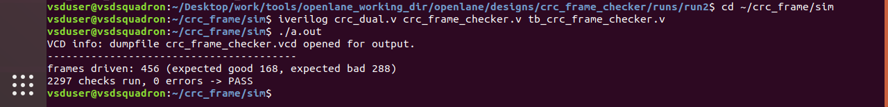

*Figure 2: Recorded RTL simulation result.*

This screenshot documents the RTL simulation stage. The testbench provides the stimulus used to check the design's behavior.

A successful simulation supports the conclusion that the design behaved as expected for the cases tested. It does not establish that every possible input sequence has been verified.

---

## 8. Functional Verification

Functional verification checks whether the RTL behaves as intended before synthesis.

I used simulation and waveform inspection to examine corrupted-frame behavior and the design's reset and idle conditions.

### 8.1 Corrupted-frame behavior

.png)

*Figure 3: Zoomed waveform covering the bad-frame test interval.*

This waveform focuses on the interval identified in the filename. It provides a closer view of the signals associated with the corrupted-frame test.

Waveform inspection helps connect the applied stimulus to the resulting signal behavior and makes it easier to investigate unexpected results.

### 8.2 Reset and idle behavior

.png)

*Figure 4: Waveform covering the initial reset and idle interval.*

Reset and idle behavior are important because the checker must begin from a known state before processing frames.

Inspecting the initial waveform helps examine the relationship between reset, the idle condition, and the start of subsequent activity.

### What I learned

- Valid frames alone are not sufficient for checking a CRC frame checker.
- Corrupted-frame tests are needed to examine CRC mismatch handling.
- Waveforms provide signal-level evidence that complements terminal output.
- Reset behavior should be checked before evaluating normal operation.

---

## 9. MeterGuard Application Demonstration

This section presents the MeterGuard smart-meter communication demonstration. The terminal output and both waveform images belong to the **same application-demo stage**; the two waveform screenshots are not separate verification projects.

The demo testbench models incoming frames and uses the checker to distinguish frames that pass the CRC check from those that fail it.

### 9.1 MeterGuard demo output

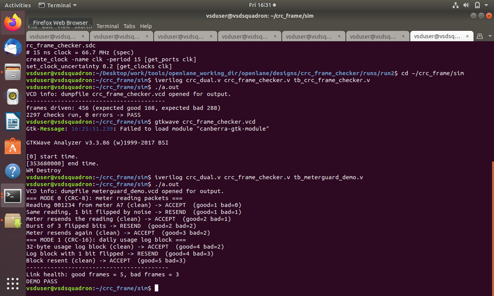

*Figure 5: Terminal output from the MeterGuard application demonstration.*

The terminal output summarizes the demonstration and its reported result.

The recorded demo reports:

- Good frames: `5`
- Bad frames: `3`
- Overall demo status: `DEMO PASS`

These figures describe the test cases executed by the demonstration testbench.

### 9.2 MeterGuard demo waveform — first view


*Figure 6: First waveform view associated with the MeterGuard application demo.*

### 9.3 MeterGuard demo waveform — second view

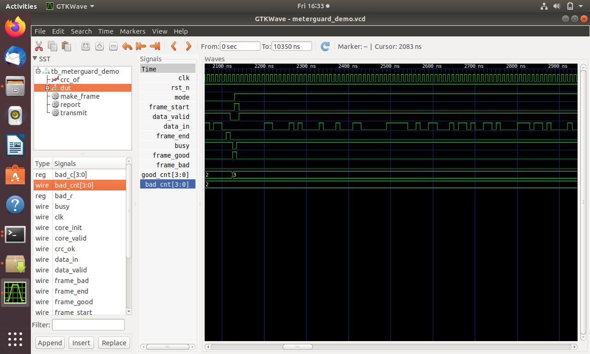

*Figure 7: Second waveform view associated with the same MeterGuard application demo.*

Both waveforms provide visual evidence of signal behavior during the application demonstration. They complement the terminal output by showing the simulated hardware activity rather than only the final summary.

### Why this demonstration matters

The demo connects the CRC frame checker to a practical use case: checking the integrity of meter-reading frames before treating them as valid.

The good and bad counters make the result easier to interpret. However, the demonstration remains a simulation; it does not prove performance on a real communication channel or on physical smart-meter hardware.

---

## 10. Logic Synthesis

After checking the RTL behavior, I used Yosys to synthesize the design.

Synthesis translates the hardware description into an implementation made from logic cells and sequential elements. The resulting statistics provide an initial view of the hardware resources used by the design.

### Yosys synthesis statistics

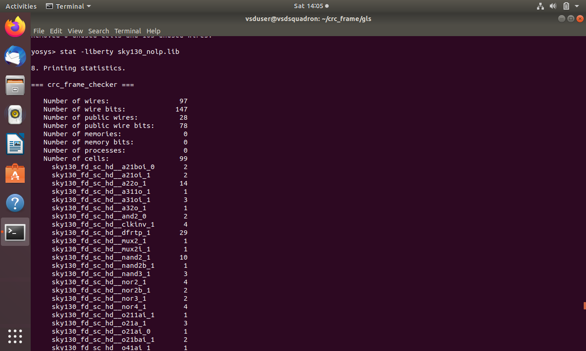

*Figure 8: Yosys synthesis statistics.*

The recorded standalone synthesis results are:

| Metric | Result |
|---|---:|
| Total cells | 99 |
| Flip-flops | 29 |
| Reported cell area | 1,179.88 µm² |

These values refer to the recorded standalone Yosys synthesis result. They should not be assumed to match the separate OpenLane synthesis, which may use different settings, libraries, and optimization steps.

### What I learned

- Synthesis turns RTL into a gate-level representation.
- Cell counts describe the mapped implementation, not the number of Verilog modules.
- Area depends on the target library and synthesis settings.
- The synthesized design still requires verification and timing analysis.

---

## 11. Gate-Level Simulation

Gate-level simulation (GLS) checks the synthesized netlist using a testbench.

RTL simulation evaluates the behavioral description, while GLS evaluates the synthesized gate-level representation. This adds another verification step after synthesis.

### Gate-level simulation result

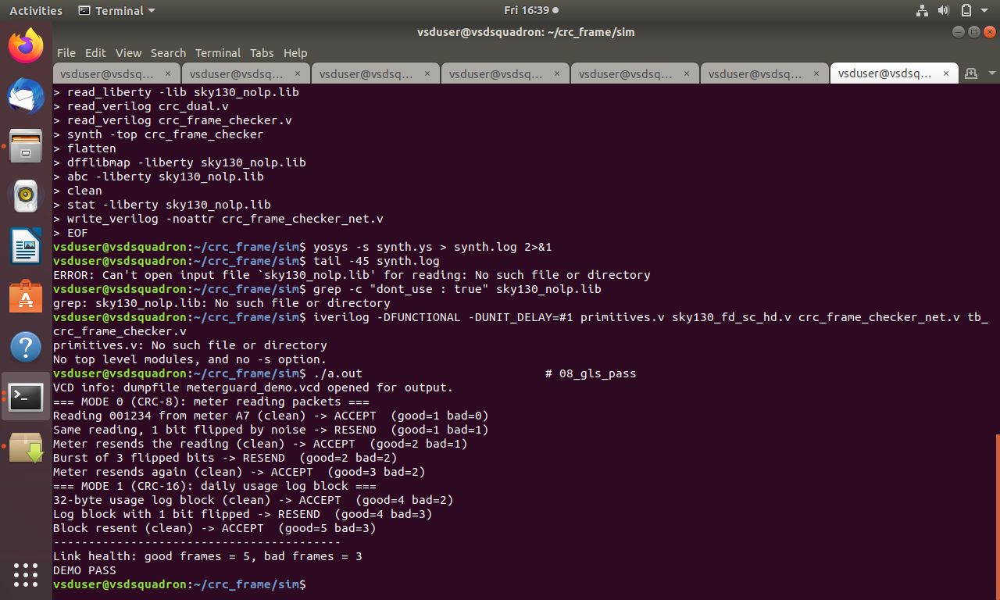

*Figure 9: Recorded gate-level simulation result.*

The recorded verification results report:

- Frames: `456`
- Checks: `2297`
- Errors: `0`

These results apply to the executed testbench and its tested cases.

### Why GLS is useful

Gate-level simulation helps check whether the synthesized implementation preserves the expected behavior. It complements RTL simulation but does not replace static timing analysis or physical verification.

---

## 12. Static Timing Analysis

Static timing analysis evaluates signal timing against the specified constraints using the design netlist and timing libraries.

Unlike functional simulation, STA analyzes timing paths rather than relying on a particular sequence of input vectors.

The project includes pre-route timing analysis across 16 process-voltage-temperature (PVT) corners.

### 12.1 Initial 10 ns timing results

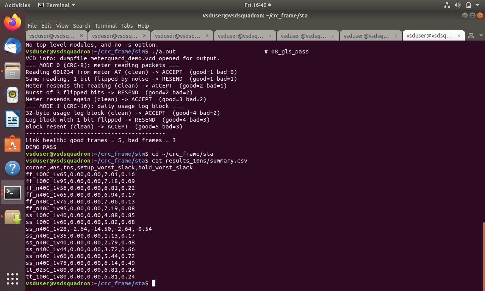

*Figure 10: Initial STA results using a 10 ns clock constraint.*

The recorded initial results show that 15 of the 16 evaluated corners passed setup timing at the 10 ns target. The corner `ss_n40C_1v28` showed a setup timing failure.

### 12.2 Understanding PVT corners

Timing can vary because of differences in process, supply voltage, and temperature.

- **Process:** Represents variation in the characteristics of the manufactured cells.
- **Voltage:** Affects cell delay and circuit behavior.
- **Temperature:** Can affect cell timing and operating conditions.

Checking multiple corners helps identify conditions where timing requirements are harder to satisfy.

### 12.3 Important timing metrics

- **Setup slack:** Measures the timing margin for a setup check.
- **Hold slack:** Measures the timing margin for a hold check.
- **WNS:** Worst negative slack, used to summarize the worst slack for the applicable timing analysis.
- **TNS:** Total negative slack across the applicable timing endpoints.

Setup and hold are different timing requirements. Reset-related recovery and removal checks are also distinct and should be interpreted from their respective reports.

---

## 13. Timing Investigation

The initial timing analysis identified a setup failure at `ss_n40C_1v28`.

The recorded failing-corner results were:

- Setup slack: `−2.64 ns`
- Setup TNS: `−14.50 ns`

These values indicate that the initial setup timing target was not met at that corner.

### 13.1 Failing-corner report

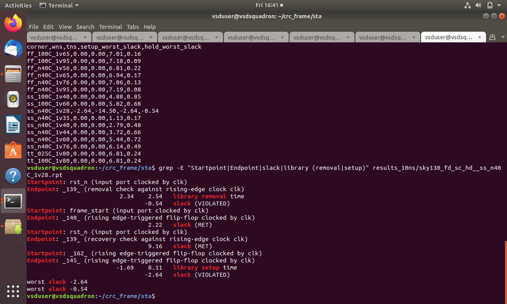

*Figure 11: Timing report used to investigate the failing corner.*

I examined the failing-corner report to investigate the timing problem. The recorded critical setup path starts at `core.crc[10]`, passes through five logic gates, and ends at flop `_145_`. The report records an arrival time of `10.74 ns` and a required time of `8.11 ns`, giving the reported setup slack of `−2.64 ns`. The initial report also shows a reset-removal issue with `−0.54 ns` slack; the library removal requirement was `2.34 ns` while the recorded arrival was `2.00 ns`.

### 13.2 Evaluation with an updated clock constraint

The project notes record a rerun using a 15 ns clock constraint and a 3 ns reset-release assumption.

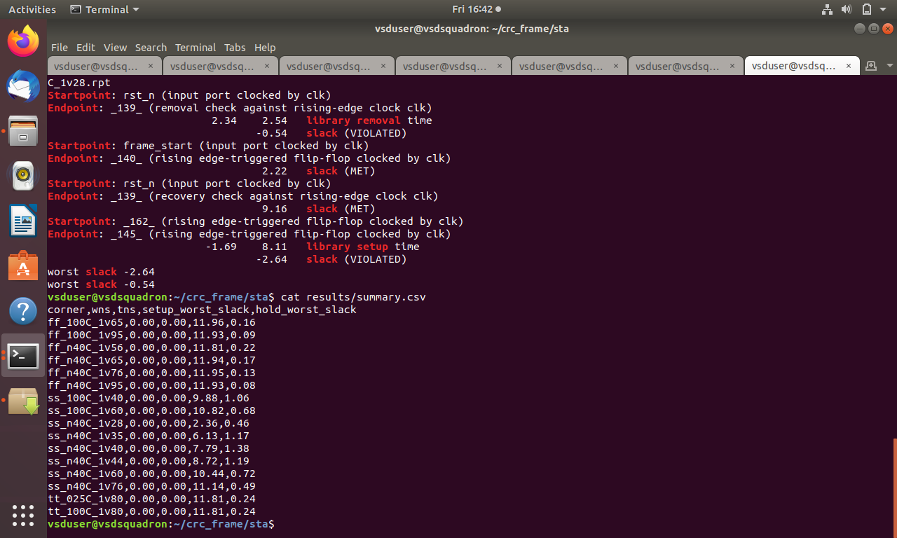

*Figure 12: STA results associated with the updated constraint.*

The table should be used to determine which checks and corners passed after the update. Changing the clock constraint changes the timing target; it does not automatically demonstrate that the circuit has been optimized to operate faster.

### What I learned

- Timing failures should be investigated using detailed reports.
- A summary table helps identify a failing corner, while path reports help explain the failure.
- Clock constraints and reset-related assumptions affect timing analysis.
- A timing result must always be interpreted in the context of its constraints and checks.

---

## 14. OpenLane Physical Design

After RTL verification, synthesis, and timing analysis, I used OpenLane to explore the physical implementation flow with the SKY130 platform.

Physical design takes the synthesized logic and develops a physical arrangement of standard cells and interconnects.

The flow includes floorplanning, power planning, placement, clock-tree synthesis, routing, parasitic extraction, timing analysis, and physical verification.

### 14.1 OpenLane configuration

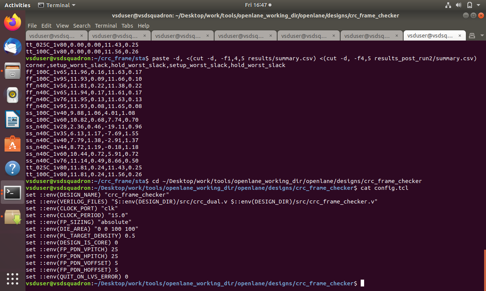

*Figure 13: OpenLane configuration evidence.*

This image documents the configuration used for the physical-design flow.

### 14.2 Flow metrics

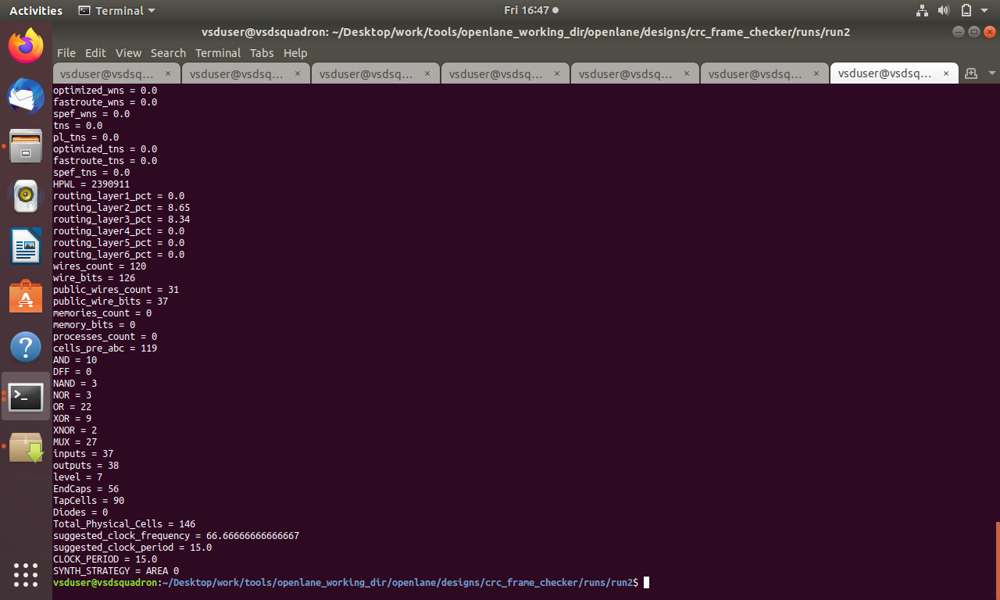

*Figure 14: Recorded physical-design flow metrics.*

The flow-metrics screenshot provides a summary of the implementation information reported by the run. The recorded OpenLane run used a `100 µm × 100 µm` die area and a target placement density of `0.5`. Its synthesis reported `119 cells`; this is a separate run from the standalone Yosys synthesis reported above (`99 cells`). During physical design, the recorded clock-tree synthesis had `29` sinks and `7` clock buffers. The global-route violation count was `0`. The final route report recorded `0` TritonRoute violations, approximately `3,436 µm` total wire length, and `942` vias. These are implementation metrics from the recorded flow, not evidence that timing closed at every corner.

---

## 15. Floorplan, Placement, Clock-Tree Synthesis, and Routing

This section documents the physical-design stages using the supplied Magic layout screenshots.

For each stage, the regular image provides an overall view and the zoomed image provides a closer view.

### 15.1 Floorplan


*Figure 15: Overall floorplan layout viewed in Magic.*


*Figure 16: Zoomed floorplan layout.*

Floorplanning establishes the physical design region and provides the foundation for later placement and routing stages.

### 15.2 Placement


*Figure 17: Overall placement layout viewed in Magic.*


*Figure 18: Zoomed placement layout.*

Placement assigns physical locations to the standard cells. Cell locations and connectivity influence wire length, congestion, and timing.

### 15.3 Clock-tree synthesis


*Figure 19: Overall clock-tree synthesis layout viewed in Magic.*


*Figure 20: Zoomed clock-tree synthesis layout.*

Clock-tree synthesis builds the clock-distribution network for sequential elements. The distribution network affects clock arrival times and therefore matters for setup and hold timing.

### 15.4 Routing


*Figure 21: Overall routed layout viewed in Magic.*


*Figure 22: Zoomed routed layout.*

Routing connects the placed cells through the available metal layers. After routing, parasitic extraction can estimate interconnect resistance and capacitance for post-route timing analysis.

---

## 16. Final GDSII Layout

GDSII is a standard database format used to represent the physical layout of an integrated circuit.

The following screenshots document the final layout views available in the repository.

### 16.1 Overall GDSII layout


*Figure 23: Overall GDSII layout viewed in Magic.*

### 16.2 Zoomed GDSII layout


*Figure 24: Zoomed view of the GDSII layout.*

The overall view shows the design as a whole, while the zoomed view makes smaller layout details easier to inspect.

Generating and viewing GDSII demonstrates progress through the physical implementation flow. It does not mean the design has been fabricated or tested in silicon.

---

## 17. Physical Verification and Signoff

Physical verification checks the layout against design rules and evaluates whether the extracted layout connectivity matches the intended circuit.

The repository contains both an earlier LVS mismatch screenshot and a combined signoff screenshot. These document different points in the implementation history and should not be treated as results from the same run.

### 17.1 Combined signoff results

.png)

*Figure 25: Combined physical-verification evidence.*

The recorded second-run results report:

- DRC errors: `0`
- LVS errors: `0`
- Antenna violations: `0`

These results refer to the recorded second signoff run.

### 17.2 Earlier LVS mismatch

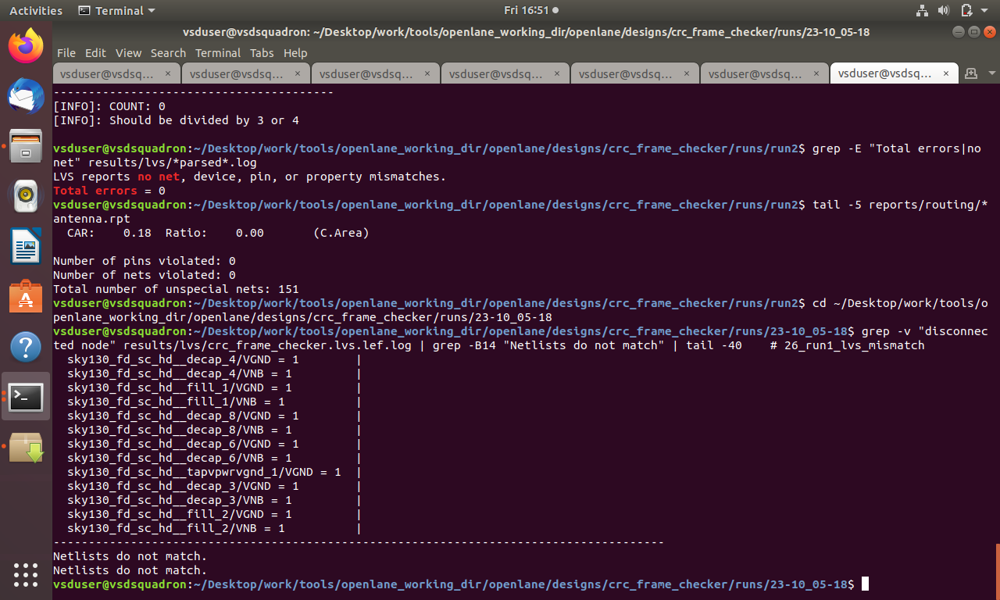

*Figure 26: LVS mismatch recorded during an earlier run.*

This image documents an earlier physical-verification issue. It is included as debugging evidence and should not be presented as the final signoff result.

The distinction matters because physical verification can identify connectivity or layout problems even when functional simulation succeeds.

### What the checks mean

- **DRC — Design Rule Check:** Evaluates whether the layout follows the applicable geometric design rules.
- **LVS — Layout Versus Schematic:** Checks whether the circuit extracted from the layout matches the intended circuit representation.
- **Antenna check:** Evaluates applicable antenna-rule violations.

The reported zero-error results are evidence from the recorded run. They do not imply foundry acceptance, fabrication, or silicon validation.

---

## 18. Results Summary

The table below summarizes the recorded results from the different project stages.

| Stage | Recorded result |
|---|---|
| RTL verification | 456 frames, 2,297 checks, 0 errors |
| MeterGuard demo | 5 good frames, 3 bad frames, `DEMO PASS` |
| Standalone Yosys synthesis | 99 cells |
| Standalone Yosys synthesis | 29 flip-flops |
| Standalone Yosys synthesis | 1,179.88 µm² reported cell area |
| Initial pre-route STA | 15 of 16 corners passed setup at 10 ns |
| Failing corner | `ss_n40C_1v28` |
| Initial failing-corner setup slack | −2.64 ns |
| Initial failing-corner setup TNS | −14.50 ns |
| Timing investigation | 15 ns clock and 3 ns reset-release assumption recorded; this does not itself prove timing closure |
| Post-route worst setup slack | −19.11 ns at `ss_n40C_1v28` |
| Post-route worst hold slack | +0.08 ns at `ff_n40C_1v95` |
| Post-route setup failures | `ss_n40C_1v28`, `ss_n40C_1v35`, `ss_n40C_1v40`, `ss_n40C_1v44` |
| Final routing | 0 TritonRoute violations; 3,436 µm total wire length; 942 vias |
| Physical verification | Second-run DRC=0, LVS=0 errors, antenna=0 |

The standalone Yosys synthesis figures and OpenLane synthesis results refer to different implementation stages and should not be treated as identical measurements.

### Post-route timing

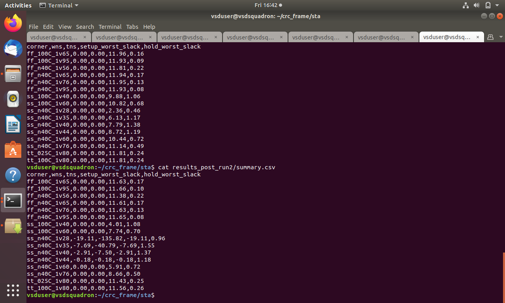

*Figure 27: Post-route static timing analysis results.*

Post-route STA evaluates timing with extracted interconnect parasitics included according to the analysis setup. The recorded post-route results show that timing closure was **not achieved at every evaluated corner**:

- Worst setup slack: `−19.11 ns` at `ss_n40C_1v28`.
- Worst hold slack: `+0.08 ns` at `ff_n40C_1v95`.
- Setup timing failed at `ss_n40C_1v28`, `ss_n40C_1v35`, `ss_n40C_1v40`, and `ss_n40C_1v44`.

The worst post-route setup result is substantially worse than the initial pre-route result at `ss_n40C_1v28`. The available reports show this change, but do not by themselves establish a single root cause. Passing DRC, LVS, and antenna checks does not mean that setup timing has passed.

### Pre-route and post-route comparison

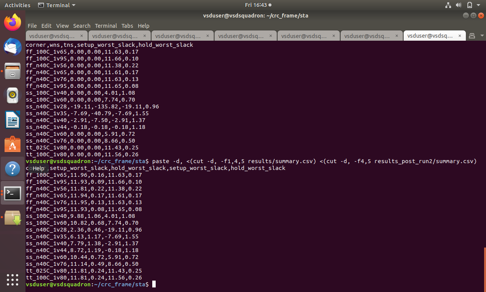

*Figure 28: Comparison of pre-route and post-route timing results.*

The comparison provides a way to review how timing results differ before and after physical implementation. The actual values and pass/fail status should be taken directly from the table.

---

## 19. Challenges and Learnings

### 19.1 Testing corrupted frames

A frame checker must be tested with both valid and corrupted data. I learned to include error cases and use waveforms to examine the behavior associated with the corrupted-frame test.

### 19.2 Understanding the difference between RTL and synthesized hardware

The Verilog source describes the design's behavior, while synthesis maps it to logic cells and sequential elements. Reviewing Yosys statistics helped me understand the implementation produced by synthesis.

### 19.3 Investigating timing failures

The initial STA results showed that one PVT corner did not meet the setup target. I learned to examine the failing report and evaluate the design under an updated constraint while keeping the timing assumptions clear.

### 19.4 Connecting the netlist to physical layout

Floorplanning, placement, clock-tree synthesis, and routing showed how a logical design becomes a physical arrangement of cells and interconnects.

### 19.5 Understanding physical verification

The earlier LVS mismatch and later signoff evidence demonstrated the importance of checking the layout after physical implementation. Passing functional simulation does not guarantee that the physical layout passes DRC or LVS.

### Overall learning

This project helped me connect the main stages of digital ASIC implementation: Verilog RTL, functional verification, synthesis, gate-level simulation, static timing analysis, physical design, layout inspection, and physical verification.

It also helped me understand how CRC-based frame checking can support communication-integrity monitoring in a smart-meter application.

---

## 20. Future Improvements

Possible future extensions include:

- Expanding the testbench to cover more frame lengths and corruption patterns.
- Adding more automated regression tests for both CRC modes.
- Testing additional reset and frame-boundary conditions.
- Documenting complete setup, hold, recovery, and removal results across all relevant corners.
- Comparing area and timing across alternative RTL implementations.
- Connecting the checker to a simulated serial communication interface.
- Extending the application demo to model retry or error-reporting behavior.
- Evaluating the design on FPGA hardware as a step toward a more complete prototype.

These are possible extensions and are not claimed as completed features of the current project.

---

## 21. Author

**Shaik Afraa Jabeen**  
Electronics and Communication Engineering

**Areas of interest:** RTL Design, Digital Verification, Static Timing Analysis, VLSI Design, and ASIC Physical Design.

GitHub: [afraajabeen-creator](https://github.com/afraajabeen-creator)

---

## Conclusion

MeterGuard demonstrates a CRC-based communication-integrity checker developed from Verilog RTL through simulation, synthesis, timing analysis, and physical implementation.

The project combines a practical smart-meter communication scenario with evidence from the main stages of the ASIC flow. The repository documents the functional tests, synthesis results, timing investigation, physical-design layouts, and signoff results.

The result is a project that demonstrates both the intended function of a CRC frame checker and the implementation steps involved in taking a digital design toward a GDSII layout.
