# VSDBabySoC – RTL Design, Synthesis and Gate-Level Simulation

## Overview

This repository documents my understanding of the RTL-to-Gate-Level flow using VSDBabySoC.

The work covers RTL simulation, functional verification, Yosys synthesis, logic optimization, technology mapping, gate-level netlist generation and Gate-Level Simulation (GLS).

A small Good MUX study is also included to understand how RTL coding style can affect synthesis and inferred hardware.

The objective is to understand what happens to an RTL design at each stage rather than simply generating a final netlist.

---

## 1. Repository Structure

```text
VSDBabySoC/
│
├── README.md
│
├── src/
│   ├── module/
│   │   ├── vsdbabysoc.v
│   │   ├── rvmyth.v
│   │   └── clk_gate.v
│   │
│   └── testbench/
│       └── testbench.v
│
├── netlist/
│   └── babysoc_netlist.v
│
├── images/
│   ├── babysoc_rtl.png
│   ├── rvmyth_hierarchy.png
│   ├── synthesis_statistics.png
│   ├── abc_technology_mapping.png
│   ├── post_optimization_statistics.png
│   ├── pre_synth_gls.png
│   └── post_synth_gls.png
│
└── mux/
    ├── good_mux.v
    ├── bad_mux.v
    ├── good_mux_rtl_simulation.png
    ├── good_mux_graphical_rep.png
    ├── good_mux_netlist.png
    └── good_mux_rtl_vs_gls.png
```

---

## 2. Tools Used

| Tool             | Purpose                                   |
| ---------------- | ----------------------------------------- |
| Icarus Verilog   | RTL and Gate-Level Simulation             |
| GTKWave          | Waveform visualization                    |
| Yosys            | RTL synthesis and netlist generation      |
| ABC              | Logic optimization and technology mapping |
| SKY130 Libraries | Technology-specific cell mapping          |
| Git              | Version control                           |
| GitHub           | Repository management and documentation   |

---

## 3. RTL-to-Gate-Level Flow

The complete flow followed in this work is:

```text
RTL Design
    ↓
RTL Simulation
    ↓
Functional Verification
    ↓
Synthesis
    ↓
Logic Optimization
    ↓
Technology Mapping
    ↓
Gate-Level Netlist
    ↓
Gate-Level Simulation
    ↓
Pre-Synthesis vs Post-Synthesis Comparison
```

The purpose of this flow is to verify that the intended functionality described at RTL is preserved after synthesis and technology mapping.

---

## 4. Good MUX 

Before working with VSDBabySoC, I studied MUX implementations to understand the relationship between RTL coding style and synthesized hardware.

A 2:1 MUX has two data inputs, one select signal and one output.

```text
                 ┌─────────────┐
        A ──────►│             │
        B ──────►│    2:1 MUX  ├────► Y
      SEL ──────►│             │
                 └─────────────┘
```

Its expected behaviour is:

```text
SEL = 0  →  Y = A
SEL = 1  →  Y = B
```

The experiment demonstrates that combinational RTL should completely specify the required output behaviour.

### Good MUX RTL Simulation

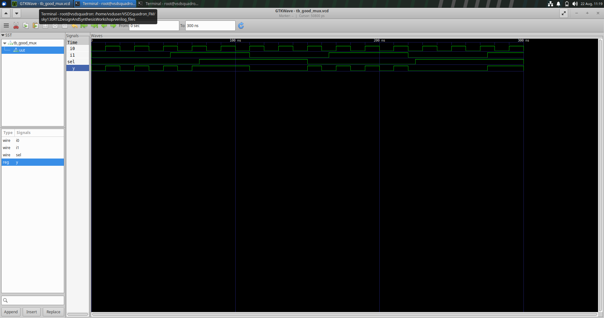

### Good MUX Graphical Representation

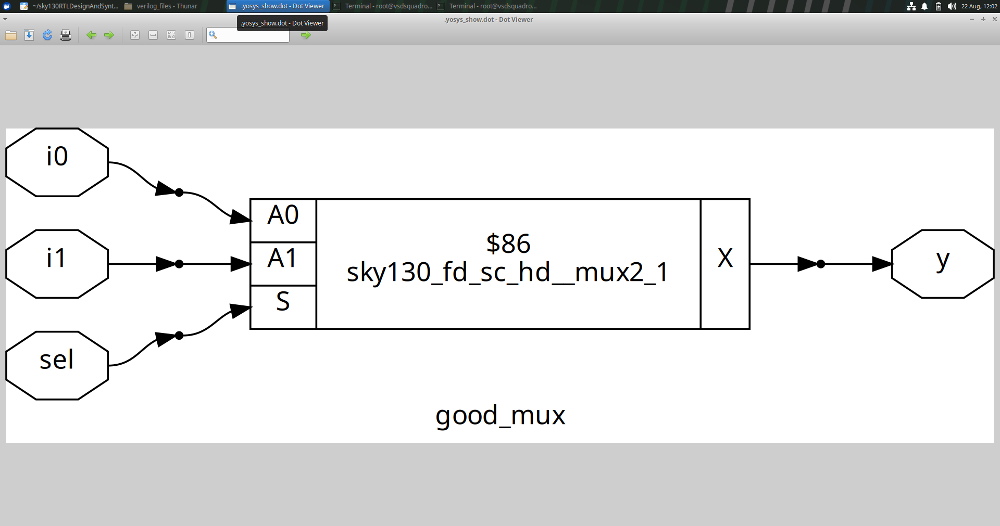

### Good MUX Synthesized Netlist

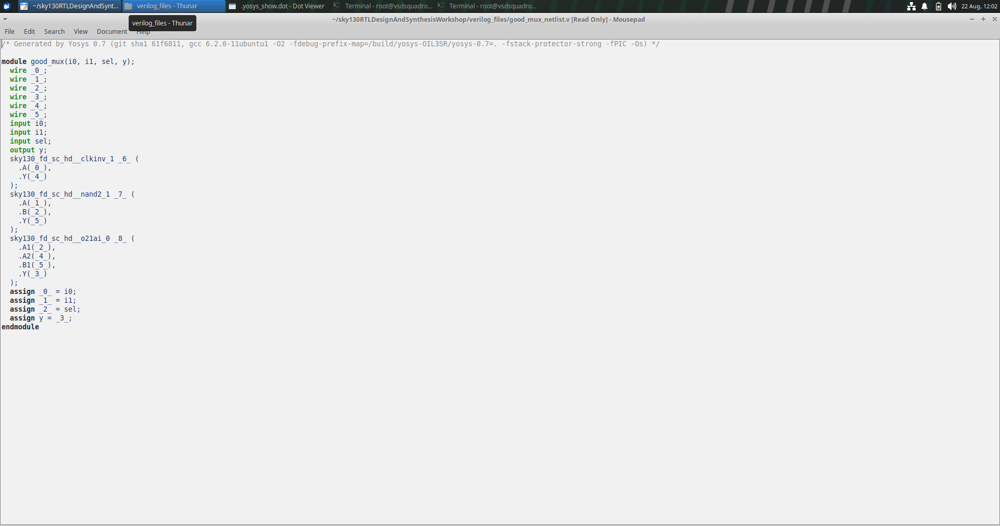

### Good MUX RTL vs Gate-Level Simulation

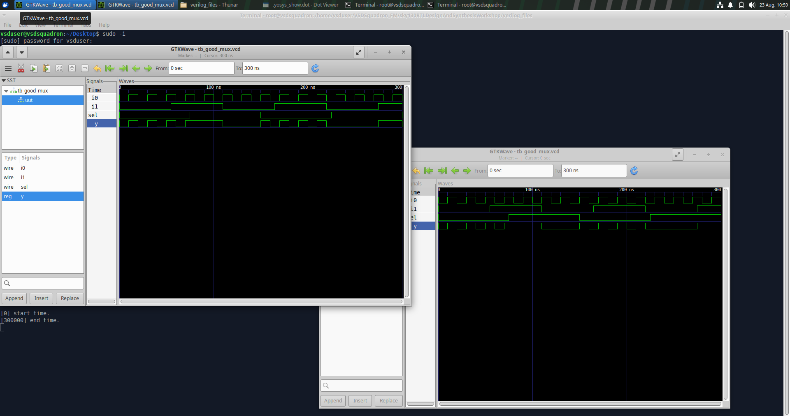

The GLS waveform confirms that the synthesized implementation maintains the intended MUX functionality.

The main learning from the MUX experiment is:

```text
RTL Coding Style
       ↓
Synthesis Interpretation
       ↓
Inferred Hardware
```

---

## 5. VSDBabySoC

VSDBabySoC is the main design used for studying the complete RTL-to-gate-level flow.

The design integrates major blocks including the PLL, RISC-V based processor core and DAC.

```text
             ┌──────────────┐
             │    avsdpll   │
             │     PLL      │
             └──────┬───────┘
                    │
                  Clock
                    │
                    ▼
             ┌──────────────┐
             │    rvmyth    │
             │  RISC-V Core │
             └──────┬───────┘
                    │
              Digital Output
                    │
                    ▼
             ┌──────────────┐
             │    avsddac   │
             │     DAC      │
             └──────┬───────┘
                    │
                    ▼
                   OUT
```

The PLL provides the clocking function, the rvmyth block performs the digital processing, and the DAC provides the output interface.

---

## 6. Design Under Test

The main Design Under Test is:

```text
vsdbabysoc
```

The main RTL file is:

[vsdbabysoc.v](src/module/vsdbabysoc.v)

Supporting RTL modules are:


[rvmyth.v](src/module/rvmyth.v)
[clk_gate.v](src/module/clk_gate.v)

The testbench is:


[testbench.v](src/testbench/testbench.v)


The testbench provides the required stimulus to the VSDBabySoC and observes its output behaviour.

---
## 7. Reading RTL into Yosys

The synthesis process begins by loading the required Verilog modules into Yosys.

```bash
yosys

read_verilog src/module/vsdbabysoc.v
read_verilog -I src/include src/module/rvmyth.v
read_verilog -I src/include src/module/clk_gate.v
```
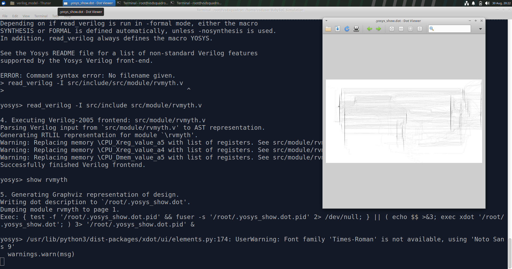
All modules required by the VSDBabySoC hierarchy must be available so that Yosys can correctly elaborate the top-level design.

---

## 8. Loading Technology Libraries

Synthesis requires information about the hardware cells available in the target technology.

The Liberty files contain information about the available cells and their characteristics.

The libraries used are:

```text
lib/avsdpll.lib
lib/avsddac.lib
lib/sky130_fd_sc_hd__tt_025C_1v80.lib
```

They are loaded using:

```bash
read_liberty -lib src/lib/avsdpll.lib 

read_liberty -lib src/lib/avsddac.lib 

read_liberty -lib src/lib/sky130_fd_sc_hd__tt_025C_1v80.lib
```

The SKY130 standard-cell library provides the cells that can be used during technology mapping.

---

## 9. RTL Synthesis

The top-level module is specified using:

```bash
synth -top vsdbabysoc
```
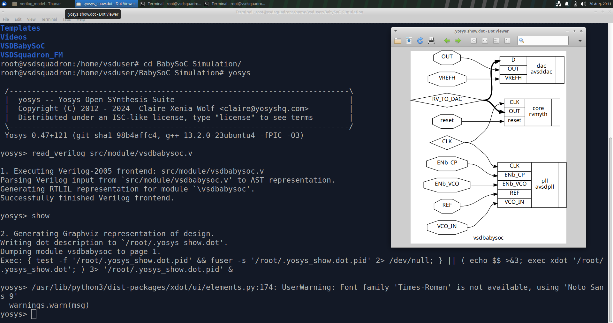

Yosys processes the RTL and converts it into a synthesized representation.

The top-level module identifies the complete design that must be synthesized.

---

## 10. Synthesis Statistics

After synthesis, Yosys reports statistics describing the resulting design.

These can include:

* Number of wires
* Number of wire bits
* Number of cells
* Sequential elements
* Combinational elements

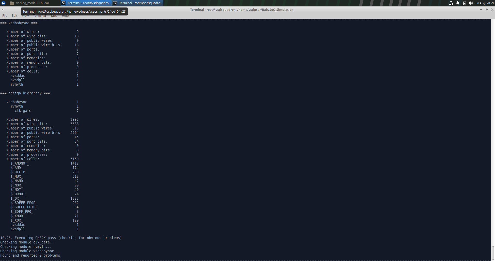

These statistics provide a quantitative view of the hardware inferred from the RTL.

---

## 11. Sequential Cell Mapping

Sequential elements such as flip-flops must be mapped to cells available in the target technology.

```bash
dfflibmap -liberty lib/sky130_fd_sc_hd__tt_025C_1v80.lib
```

This maps generic sequential elements to technology-specific sequential cells.

---

## 12. Logic Optimization

The synthesized design can be optimized using:

```bash
opt
```

Optimization attempts to simplify the circuit without changing its intended functionality.

Typical transformations include:

* Constant propagation
* Removal of redundant logic
* Boolean simplification
* Removal of unused logic
* Simplification of connections

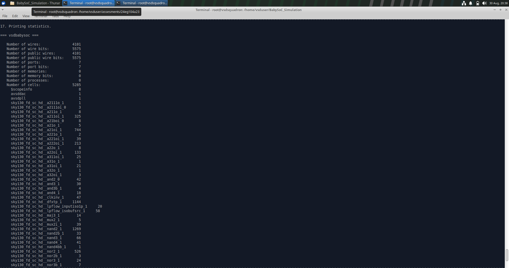

---

## 13. Technology Mapping with ABC

ABC performs combinational logic optimization and technology mapping.

```bash
abc -liberty lib/sky130_fd_sc_hd__tt_025C_1v80.lib
```

The generic combinational logic is mapped to cells available in the SKY130 library.

```text
Generic Logic
      ↓
     ABC
      ↓
SKY130 Standard Cells
```

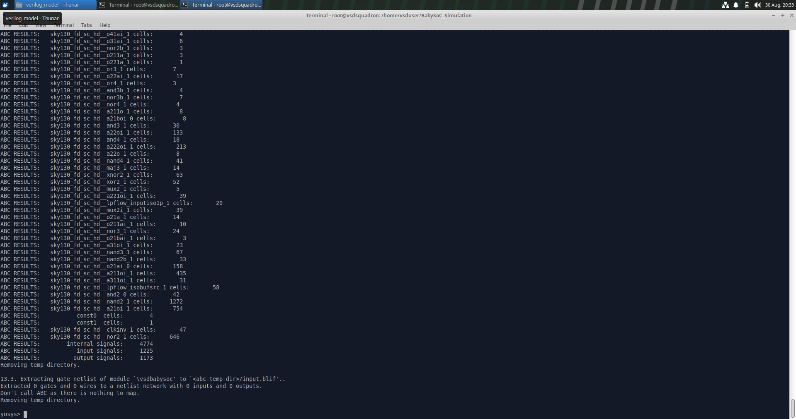

---

## 14. Synthesized Design Visualization

The synthesized design can be visualized using:

```bash
show vsdbabysoc
```


The generated representation provides a structural view of the synthesized hardware.

It helps demonstrate the transformation from RTL-level logic into interconnected hardware cells.

---

## 15. Preparing the Final Netlist

Before writing the final gate-level netlist, the design is flattened and cleaned.

```bash
flatten
setundef -zero
clean -purge
rename -enumerate
```

The purpose of these commands is:

```text
flatten
→ Removes hierarchical boundaries

setundef -zero
→ Converts undefined values to zero

clean -purge
→ Removes unnecessary design objects

rename -enumerate
→ Systematically renames internal objects
```

---

## 16. Gate-Level Netlist Generation

The final synthesized representation is written as a Verilog netlist.

```bash
write_verilog -noattr netlist/babysoc_netlist_new.v
```

The generated file is stored at:

[Netlist](netlist/baby_soc_netlist_new.v)


The netlist represents the synthesized implementation rather than the original RTL description.

---

## 17. RTL vs Gate-Level Representation

The gate-level implementation may look very different from the RTL even though the intended functionality is the same.

For example:

```verilog
if (sel)
    y = b;
else
    y = a;
```

may be implemented using a MUX cell or an equivalent combination of standard cells.

Therefore:

```text
RTL Structure
     ≠
Gate-Level Structure
```

while the desired relationship is:

```text
RTL Functionality
     =
Gate-Level Functionality
```

Synthesis can optimize, merge, remove, rename and restructure internal logic.

---

## 18. Gate-Level Simulation

Gate-Level Simulation uses the synthesized netlist instead of the original RTL.

The verification flow is:

```text
             RTL
              ↓
       RTL Simulation
              ↓
      Reference Behaviour
              ↓
          Synthesis
              ↓
       Gate-Level Netlist
              ↓
        GLS Simulation
              ↓
      Functional Comparison
```

GLS provides an additional verification stage after synthesis.

---

## 19. Pre-Synthesis GLS Reference

The pre-synthesis simulation represents the original RTL implementation and provides the reference waveform.

For pre-synthesis simulation, the following command was used:

```bash
iverilog -o ./pre_synth_sim.out -DPRE_SYNTH_SIM src/module/testbench.v -I src/include -I src/module/
```

### What this command does

| Command                  | Purpose                                           |
| ------------------------ | ------------------------------------------------- |
| `iverilog`               | Compiles the Verilog files                        |
| `-o ./pre_synth_sim.out` | Creates the simulation output file with this name |
| `-DPRE_SYNTH_SIM`        | Defines the macro for pre-synthesis simulation    |
| `src/module/testbench.v` | Testbench used to simulate the design             |
| `-I src/include`         | Adds the include folder                           |
| `-I src/module/`         | Adds the module folder                            |

This simulation checks the RTL design before converting it into a gate-level netlist.


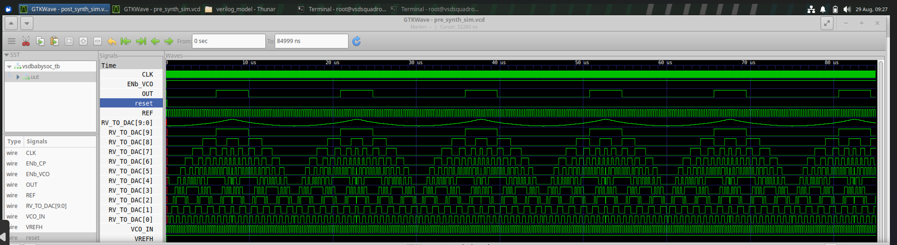

The important input and output signals are observed to establish the expected functional behaviour.

---

## 20. Post-Synthesis GLS

The post-synthesis simulation uses:

```text
Testbench
     +
Gate-Level Netlist
     +
Required Technology Verilog Models
```
Unlike pre-synthesis simulation, this stage does not use only the original RTL logic. The synthesized netlist and standard cell models are used.

The command used was:

```bash
sudo iverilog -DPOST_SYNTH_SIM -DFUNCTIONAL \
-I src/include/ \
-I ../../sky130RTLDesignAndSynthesisWorkshop/my_lib/verilog_model/ \
-I src/module/ \
src/module/testbench.v
```

The resulting waveform represents the behaviour of the synthesized gate-level implementation.

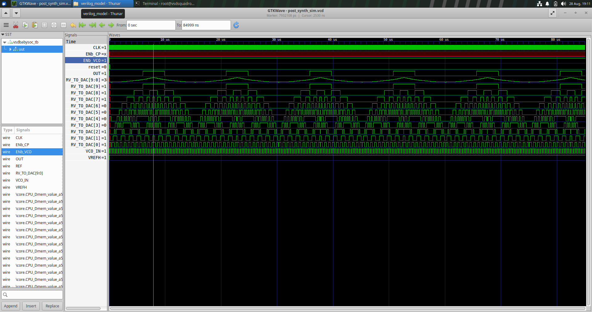

---

## 21. Pre-Synthesis vs Post-Synthesis Comparison

The pre-synthesis and post-synthesis waveforms are compared to verify that synthesis has preserved the intended functionality.

The comparison focuses on meaningful observable signals such as inputs, reset, clock-related behaviour and outputs.

The goal is:

```text
Expected RTL Behaviour
        ↓
Synthesized Implementation
        ↓
Observed GLS Behaviour
```
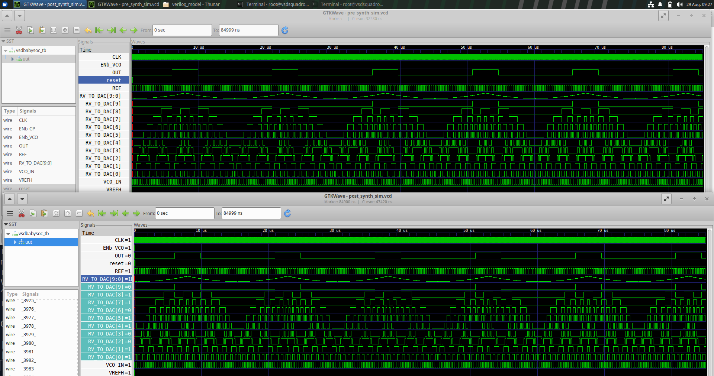

Internal signals may differ because synthesis can change the internal implementation.

---

## 22. Why Internal Waveforms Can Differ

Synthesis may perform:

* Logic optimization
* Constant propagation
* Logic merging
* Redundant logic removal
* Technology mapping
* Hierarchy flattening
* Internal signal renaming

Therefore, the internal gate-level structure does not have to be identical to the RTL structure.

A different internal waveform does not automatically indicate a functional error.

The important comparison is the behaviour of the relevant observable signals and outputs.

---

## 23. RTL vs Gate-Level

| RTL                              | Gate-Level                           |
| -------------------------------- | ------------------------------------ |
| Higher abstraction               | Lower abstraction                    |
| Behaviour-oriented               | Structure-oriented                   |
| Easier to read                   | More detailed                        |
| Technology independent           | Technology mapped                    |
| Describes intended functionality | Describes cell connectivity          |
| Used for functional verification | Used for post-synthesis verification |

---

## 24. Role of the SKY130 Standard-Cell Library

The standard-cell library determines which technology-specific cells can be used during mapping.

The relationship is:

```text
RTL
 ↓
Generic Logic
 ↓
Technology Mapping
 ↓
SKY130 Standard Cells
```

Examples of standard-cell types include:

```text
INV
NAND
NOR
AND
OR
XOR
MUX
D Flip-Flop
```

Therefore, the selected technology library influences the structure of the final gate-level netlist.

---

## 25. Important Observations

### RTL Coding Matters

The MUX experiments demonstrated that RTL coding style influences how synthesis interprets the design.

### Synthesis Changes Structure

The gate-level netlist can be structurally very different from the RTL.

### Optimization Changes the Implementation

Redundant or unnecessary logic may be simplified or removed while preserving functionality.

### Technology Libraries Matter

The available technology library determines the cells used during technology mapping.

### GLS Is Important

RTL simulation verifies the original RTL, while GLS verifies the synthesized gate-level implementation.

### Internal Signals Can Change

Synthesis may rename, optimize or remove internal signals, so functional comparison should focus on meaningful signals and outputs.

---

## 26. Complete Synthesis Command Flow

```bash
yosys

read_verilog src/module/vsdbabysoc.v
read_verilog -I src/include src/module/rvmyth.v
read_verilog -I src/include src/module/clk_gate.v

read_liberty -lib lib/avsdpll.lib
read_liberty -lib lib/avsddac.lib
read_liberty -lib lib/sky130_fd_sc_hd__tt_025C_1v80.lib

synth -top vsdbabysoc

dfflibmap -liberty lib/sky130_fd_sc_hd__tt_025C_1v80.lib

opt

abc -liberty lib/sky130_fd_sc_hd__tt_025C_1v80.lib

check

show vsdbabysoc

flatten
setundef -zero
clean -purge
rename -enumerate

write_verilog -noattr netlist/babysoc_netlist_new.v
```

---


## 27. Learning Outcome

This work provided practical understanding of how an RTL design progresses toward a technology-mapped gate-level implementation.

The main flow studied was:

```text
RTL Coding
     ↓
RTL Simulation
     ↓
Functional Verification
     ↓
Synthesis
     ↓
Logic Optimization
     ↓
Sequential Cell Mapping
     ↓
Technology Mapping
     ↓
Gate-Level Netlist
     ↓
Gate-Level Simulation
     ↓
Functional Comparison
```

The MUX experiments established the connection between RTL coding style and inferred hardware.

The VSDBabySoC experiment extended this understanding to a larger hierarchical design and demonstrated the complete synthesis and GLS flow.

The main takeaway is that RTL design is not only about writing code that produces the expected simulation output. It is also necessary to understand how synthesis interprets the RTL, how optimization changes the implementation, how technology libraries influence the mapped hardware, and how the resulting gate-level implementation can be verified.

---

---

# PART 2 — STATIC TIMING ANALYSIS AND PHYSICAL DESIGN

## 28. Static Timing Analysis Using OpenSTA

### 28.1 Introduction

Static Timing Analysis (STA) evaluates the timing behaviour of a digital circuit without requiring exhaustive functional simulation. It analyses signal propagation delays and checks whether timing paths satisfy the specified timing constraints.

OpenSTA is an open-source static timing analysis tool. In this work, it was used to examine timing paths in VSDBabySoC using SKY130 HD standard-cell timing libraries.

The analysis involves loading the design netlist, timing constraints and libraries, generating timing reports, and evaluating timing behaviour across different Process, Voltage and Temperature (PVT) conditions.

### 28.2 Important Timing Parameters

| Parameter | Description |
|---|---|
| Startpoint | Beginning of a timing path |
| Endpoint | End of a timing path |
| Arrival time | Time at which a signal reaches the endpoint |
| Required time | Time by which the signal must arrive |
| Slack | Difference between required time and arrival time, interpreted according to the timing check |
| WNS | Worst Negative Slack; the worst reported timing slack |
| TNS | Total Negative Slack; accumulated negative slack across violating paths |

Positive slack generally indicates that a path meets its timing requirement. Negative slack indicates a timing violation.

### 28.3 OpenSTA Commands

Check whether OpenSTA is available in the VM:

```bash
which sta
sta -version
```

The following command was used to inspect minimum- and maximum-delay timing paths:

```tcl
report_checks -path_delay min_max -fields {nets cap slew input_pins fanout}
```

The report provides timing-path details, including net information, capacitance, slew, input pins and fanout.

---

## 29. Static Timing Analysis on VSDBabySoC — VM

### 29.1 Overview

Static Timing Analysis was performed on the synthesized VSDBabySoC design in the virtual machine using OpenSTA and SKY130 HD timing libraries.

This analysis focuses on the pre-route design. The results help identify timing violations and understand how timing behaviour changes across PVT corners.

The VM screenshots are stored in the `images/` directory. The original filenames contain `(report checks)`.

### 29.2 VM Run TCL Script

The following screenshots document the two parts of the VM `run.tcl` file.

**Part 1**

.png)

**Part 2**

.png)

### 29.3 VM Timing Reports — Representative Corners

The VM reports contain two screenshot parts for each selected corner. The filenames below preserve the names shown in your PDF.

#### Corner 1: SS, -40°C, 1.28 V

This corner produced the following pre-route timing results:

| Metric | Value |
|---|---:|
| WNS | -62.56 ns |
| TNS | -13957.59 ns |

**Report checks — Part 1**

-1.png)

**Report checks — Part 2**

-2.png)

#### Corner 2: SS, -40°C, 1.35 V

**Report checks — Part 1**

-1.png)

**Report checks — Part 2**

-2.png)

#### Corner 3: SS, -40°C, 1.44 V

**Report checks — Part 1**

-1.png)

**Report checks — Part 2**

-2.png)

#### Corner 4: SS, 100°C, 1.40 V

**Report checks — Part 1**

-1.png)

**Report checks — Part 2**

-2.png)

### 29.4 VM WNS and TNS Graphs

The WNS graph helps identify the worst reported slack across the evaluated corners. The TNS graph shows the accumulated negative slack of violating paths.

**VM WNS graph**


**VM TNS graph**


### 29.5 Observations

- The VM analysis examines the synthesized design before routing.
- The reported timing results vary across the selected timing libraries.
- The `ss_n40C_1v28` corner shows substantial negative WNS and TNS.
- WNS and TNS provide complementary information about timing violations.
- These results belong to the VM pre-route analysis and must be distinguished from the Codespace post-route results.

---

## 30. SKY130 Timing Libraries — PVT Corners

### 30.1 Introduction

Timing libraries provide timing and electrical models for standard cells. These models allow tools to estimate cell delays under specified operating conditions.

PVT stands for:

- **Process:** Manufacturing-process variation.
- **Voltage:** Supply-voltage condition.
- **Temperature:** Operating-temperature condition.

Different PVT conditions can produce different cell delays, so analysing multiple corners helps evaluate timing behaviour across operating conditions.

### 30.2 SKY130 HD Timing Libraries

The SKY130 HD timing-library directory was inspected in the VM. The library filenames identify their process corner, temperature and supply-voltage conditions.

The libraries were used as inputs to the timing analysis. The GitHub repository documents the library inspection and analysis results; the complete timing-library files do not need to be uploaded.

### 30.3 Process Corner Categories

| Corner | Description |
|---|---|
| FF | Fast-Fast |
| SS | Slow-Slow |
| TT | Typical-Typical |

The VM analysis evaluated 16 corners: 6 FF, 8 SS and 2 TT.

---

## 31. PVT Corner-Based STA — Codespace

### 31.1 Overview

A separate multi-corner Static Timing Analysis was performed in Codespace using the VSDBabySoC physical-design environment.

Unlike the VM analysis, the Codespace report evaluates the routed design using OpenROAD and the associated timing constraints.

The analysis covers minimum- and maximum-delay timing behaviour across 16 PVT corners.

The Codespace screenshots are stored in `images_codespace/`. Their filenames use `rpt(1)` and `rpt(2)` for the two parts of each corner report.

### 31.2 Analysis Setup

The Codespace report documents the following files and directories:

| Item | Path |
|---|---|
| Routed design database | `results/sky130hd/vsdbabysoc/base/5_route.odb` |
| Timing constraints | `results/sky130hd/vsdbabysoc/base/5_route.sdc` |
| Standard-cell timing libraries | `designs/sky130hd/vsdbabysoc/libs/timing/` |
| PLL timing library | `designs/sky130hd/vsdbabysoc/lib/avsdpll.lib` |
| DAC timing library | `designs/sky130hd/vsdbabysoc/lib/avsddac.lib` |
| Report directory | `reports/sta_minmax_16/` |
| Summary CSV | `reports/sta_minmax_16/minmax_slack_summary.csv` |
| TCL script | `/tmp/sta_minmax.tcl` |

These paths describe the Codespace analysis environment.

### 31.3 Codespace TCL Scripts

**Additional STA script**

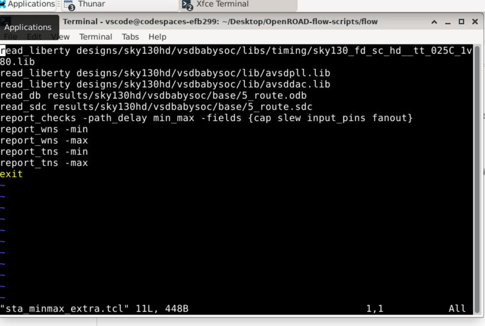

### 31.4 Timing Report Commands

The following commands were used to inspect timing paths and report slack metrics:

```tcl
report_checks -path_delay min_max -fields {nets cap slew input_pins fanout}

report_wns -min
report_wns -max

report_tns -min
report_tns -max
```

Minimum-delay and maximum-delay checks evaluate different timing requirements and must be interpreted separately.

### 31.5 PVT Corner Coverage

| Corner group | Number of corners |
|---|---:|
| FF | 6 |
| SS | 8 |
| TT | 2 |
| **Total** | **16** |

### 31.6 Codespace Timing Reports — Four Representative Corners

The post-route report recorded maximum-delay violations in five SS corners. The following four reports show representative results for the corners with the most negative reported WNS values.

#### Corner 1: SS, -40°C, 1.28 V

| Metric | Value |
|---|---:|
| WNS | -20.83 ns |
| TNS | -5815.72 ns |

**Report — Part 1**


**Report — Part 2**

.png)

#### Corner 2: SS, -40°C, 1.35 V

| Metric | Value |
|---|---:|
| WNS | -10.66 ns |
| TNS | -2019.57 ns |

**Report — Part 1**

.png)

**Report — Part 2**

.png)

#### Corner 3: SS, -40°C, 1.40 V

| Metric | Value |
|---|---:|
| WNS | -6.36 ns |
| TNS | -762.02 ns |

**Report — Part 1**

.png)

**Report — Part 2**

.png)

#### Corner 4: SS, -40°C, 1.44 V

| Metric | Value |
|---|---:|
| WNS | -3.82 ns |
| TNS | -168.54 ns |

**Report — Part 1**

.png)

**Report — Part 2**

.png)

### 31.7 Codespace Summary Report

The summary report provides an overview of the multi-corner timing analysis.

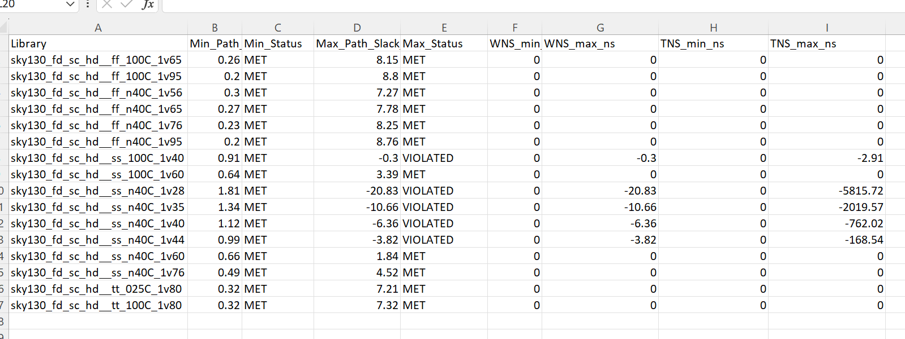

### 31.8 Codespace WNS and TNS Graphs

**Codespace WNS graph**


**Codespace TNS graph**


### 31.9 Observations

- The Codespace analysis evaluates the routed VSDBabySoC design.
- Five SS corners showed maximum-delay timing violations.
- The `ss_n40C_1v28` corner produced the most negative reported WNS.
- WNS indicates the worst reported slack, while TNS represents accumulated negative slack.
- The VM and Codespace results represent different analysis stages and should not be treated as interchangeable.
- The full set of corner reports is retained in the repository as supporting evidence.

---

## 32. Physical Design Flow Using OpenROAD

### 32.1 Introduction

OpenROAD was used to explore the physical-design flow of VSDBabySoC using the SKY130 HD platform.

The flow includes synthesis, floorplanning, placement and routing. Each stage contributes to transforming the synthesized design into a physical implementation.

The design configuration used was:

```text
./designs/sky130hd/vsdbabysoc/config.mk
```

Run the following commands from the OpenROAD flow directory containing this configuration file.

### 32.2 Synthesis

Synthesis generates a gate-level implementation from the RTL using the selected technology libraries.

```bash
make DESIGN_CONFIG=./designs/sky130hd/vsdbabysoc/config.mk synth
```

### 32.3 Floorplanning

Floorplanning establishes the initial physical organisation of the design, including the floorplan area and placement region.

```bash
make DESIGN_CONFIG=./designs/sky130hd/vsdbabysoc/config.mk floorplan
```

### 32.4 Placement

Placement assigns physical locations to standard cells within the placement region.

```bash
make DESIGN_CONFIG=./designs/sky130hd/vsdbabysoc/config.mk place
```

### 32.5 Routing

Routing connects the placed standard cells using the available metal layers.

```bash
make DESIGN_CONFIG=./designs/sky130hd/vsdbabysoc/config.mk route
```

### 32.6 Physical Design Observations

- Synthesis generates a technology-mapped gate-level design.
- Floorplanning establishes the initial physical organisation.
- Placement assigns locations to standard cells.
- Routing creates physical connections between cells.
- The routed design provides physical interconnect information for more detailed timing analysis.

---

## 33. Key Learning Outcomes — Part 2

This part of the workshop extended the understanding of digital implementation from synthesis to static timing analysis and physical design.

The main concepts studied were:

1. **Static Timing Analysis:** Evaluating timing paths using design constraints and timing libraries.
2. **OpenSTA:** Using TCL scripts and timing commands to inspect timing paths.
3. **Timing metrics:** Understanding arrival time, required time, slack, WNS and TNS.
4. **SKY130 timing libraries:** Understanding timing models for different PVT conditions.
5. **Multi-corner STA:** Evaluating timing behaviour across 16 PVT corners.
6. **Pre-route and post-route analysis:** Distinguishing VM results from Codespace routed-design results.
7. **OpenROAD physical design:** Exploring synthesis, floorplanning, placement and routing.
8. **Timing violations:** Identifying operating conditions under which maximum-delay timing requirements were not met.

The VM report showed substantial negative slack in the `ss_n40C_1v28` pre-route analysis. The Codespace post-route report also identified five SS corners with maximum-delay violations, with `ss_n40C_1v28.lib` producing the most negative reported WNS.

These results demonstrate the importance of evaluating timing across multiple PVT conditions and interpreting results according to the implementation stage.

---

## 34. Conclusion

This work provided practical experience with the progression from RTL synthesis to static timing analysis and physical design using VSDBabySoC.

The VM OpenSTA analysis was used to inspect pre-route timing paths, while the Codespace analysis evaluated the routed design across 16 PVT corners. The SKY130 timing-library inspection helped explain why timing behaviour varies across operating conditions.

The OpenROAD flow connected timing analysis with physical implementation through synthesis, floorplanning, placement and routing.

Overall, this work demonstrated how timing constraints, standard-cell libraries, PVT conditions and physical implementation influence the timing behaviour of a digital circuit.

---

**Tools and technologies:** VSDBabySoC · Yosys · OpenSTA · OpenROAD · SKY130 HD · TCL · Static Timing Analysis · PVT Corner Analysis
